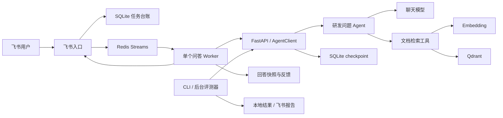

# SupportPilot

一键启动团队工作台：`python scripts/start.py --demo --admin-email admin@example.com`。GitHub Actions 已配置 lint、pytest、前端检查和 GHCR 镜像发布，详见[一键启动与 CI/CD](docs/ci-cd.md)。

新增可选的[多租户团队工作台与 PostgreSQL 业务持久化](docs/multi-tenancy.md)：登录、团队切换、成员角色、知识库隔离、会话归属、回答快照和反馈。默认关闭，启用步骤与兼容边界见文档。

公网演示使用独立 NGINX + LiteLLM 栈，支持邮箱验证注册和演示额度。详见[阿里云部署](docs/aliyun-deployment.md)与[安全验证记录](docs/security-validation.md)。

只展示界面和完整问答流程时，可用[零后端静态演示](docs/static-demo.md)：`cd frontend && npm run dev:demo`，账号密码均为 `guest`，无需服务器或模型密钥。

React 网页工作台支持提问、流式回答、历史会话和文档证据展示，本地启动见 [frontend/README.md](frontend/README.md)。

面向研发问题排查的飞书 Agent：结合用户描述和已导入的知识文档，补充复现信息、提供带出处的排查建议，并整理开发者交接报告。

## 使用场景

- 接口异常：梳理请求、预期和实际结果，按需追问状态码、日志和最近变更。
- 启动、配置或依赖异常：整理启动命令、运行环境和错误堆栈，给出待验证的排查方向。
- 测试失败与版本回归：归纳失败用例、版本差异及复现步骤，生成交接摘要。
- 文档辅助排查：检索已经导入 Qdrant 的飞书文档，返回相关片段与来源链接。

例如，用户描述“升级后浏览器跨域请求失败”，机器人可以追问请求和环境、检索已入库的跨域文档，再给出有依据的检查步骤。它不会执行用户环境中的命令，也不会把文档案例直接当成当前故障的确定根因。

## 已实现能力

| 能力 | 实现与边界 |
| --- | --- |
| 飞书问答 | 长连接接收机器人单聊文本，回答使用可评价的交互卡片 |
| 文档 RAG | 单篇文档读取、切分、Embedding、Qdrant 入库及检索工具；不自动同步整库 |
| 多轮会话 | SQLite 保存会话列表与当前选择，LangGraph checkpoint 保存消息历史 |
| 回答反馈 | 先保存问题、答案和运行标识，再发卡片；检查提交归属，首个有效评价生效 |
| 任务恢复 | 可选 Redis Streams、原子去重及 TTL；排队任务恢复，已保存回答复用，结果不明时待人工确认 |
| 回归评测 | 固定 10 案例、12 轮；复用 AgentClient，留存答案、工具消息、检索证据、规则结果与耗时 |
| 飞书报告 | 菜单或命令发起后台评测，发布文档、授予发起人阅读权限、发送完成卡片；发布失败保留本地报告 |

## 架构概览



上图展示启用 Redis 的模式。配置模板使用 `FEISHU_QUEUE_BACKEND=redis`，需要先启动 Redis；未配置该变量时，程序默认使用内存队列。各数据库的职责、标识和失败分支见 [架构说明](docs/architecture.md)。

## 启动

当前交付方式为 **Python 本地运行 FastAPI 和飞书入口，Docker 运行 Redis、Qdrant**。完整应用镜像尚未适配本次业务扩展，根目录 `compose.yaml` 不是本版启动入口。

先阅读 [启动与运维说明](docs/getting-started.md)，完成模型、飞书权限和知识文档导入。以下命令均在项目根目录的 PowerShell 执行：

```powershell
# Use uv 0.13.5 for the dependency cooldown configuration.
uvx --from uv==0.13.5 uv sync --frozen --group feishu --group rag
docker compose -f docker/compose.redis.yaml up -d --wait
docker compose -f docker/compose.qdrant.yaml up -d
```

两个终端分别运行，并保持运行：

```powershell
.\.venv\Scripts\python.exe src/run_service.py
```

```powershell
.\.venv\Scripts\python.exe src/run_feishu.py
```

首次配置需要从 `.env.example` 创建 `.env`；已有 `.env` 请保留。后端必须提供 `dev-issue-agent`，模型需要支持工具调用。只启动容器不会自动导入知识文档。

## 使用与评测

在机器人单聊中直接提问。会话和评测操作可使用菜单，也可使用以下命令：

| 命令 | 用途 |
| --- | --- |
| `/new` | 新建并切换到新会话 |
| `/history` | 查看历史会话并选择继续 |
| `/current` | 查看当前会话 |
| `/eval` | 发起后台回归任务 |
| `/eval-status` | 查询自己的最新评测任务 |

本地快速验证与完整评测：

```powershell
# 只校验案例，不启动模型或调用后端。
.\.venv\Scripts\python.exe scripts/evaluate_supportpilot.py --validate-only
# 后端运行后，仅评测一个案例。
.\.venv\Scripts\python.exe scripts/evaluate_supportpilot.py --case SP01
# 默认完整 10 案例、12 轮；不要求启动飞书入口。
.\.venv\Scripts\python.exe scripts/evaluate_supportpilot.py
```

结果保存在 `evals/supportpilot/runs/<运行编号>/`，包括案例快照、manifest、JSONL、汇总和 Markdown 报告。飞书后台使用相同评测器，但案例路径由 `FEISHU_EVAL_CASES_PATH` 选择；该配置不改变 CLI 默认案例。

**规则通过率不等于答案正确率。** 当前答案质量仍待人工复核；链接检查存在将配置示例 URL 当成引用的已知误判，尚未修复。测试数量与模型回答质量分别记录，不用自动测试通过数代表业务准确率。

## 文档导航

| 文档 | 内容 |
| --- | --- |
| [启动与运维](docs/getting-started.md) | 环境、配置、文档导入、启动顺序、查询与故障处理 |
| [架构说明](docs/architecture.md) | 问答与评测调用路径、标识、存储和恢复策略 |
| [运维操作](docs/operations.md) | 任务查询与恢复、索引冲突、报告发布和调用追踪 |
| [业务扩展与贡献说明](docs/contributions.md) | 原框架与新增工作的边界、代码证据和设计取舍 |
| [固定案例与评测](evals/supportpilot/README.md) | 案例结构、执行器和结果格式 |

## 当前限制

- 飞书仅接收用户单聊文本；普通问题、菜单和卡片操作顺序处理，长问题可能延迟后续操作。
- 每个本地任务台账只运行一个问答 Worker；飞书调度的评测任务同一作用域也限制为一个活动任务，手动 CLI 不受该调度锁限制。
- Redis 配合 SQLite 恢复业务阶段，不提供 Agent 任意节点断点续跑或严格一次执行；未知调用结果不会自动重跑。
- RAG 只查询手动导入的文档；整库扫描、更新删除同步、历史 Issue 检索和命令执行未实现。
- SQLite 模式的 checkpoint 持久化，但 LangGraph Store 仍为内存实现；不宣称拥有持久跨会话长期记忆。
- 当前未接入业务多 Agent 协作，也未完成多机器部署、吞吐量评估或生产级可用性验证。

## 开发验证

Prometheus + Grafana 的启动、指标口径、预置看板和告警验收见 [运行监控](monitoring/README.md)。
Langfuse Cloud 的任务关联、正文屏蔽和云端验收见 [调用追踪](docs/operations.md)。
任务流水、时间筛选、数据库升级和恢复审计见 [任务审计](docs/operations.md)。

安装上述依赖时默认包含 dev 组，可运行有针对性的测试：

```powershell
.\.venv\Scripts\python.exe -m pytest tests/test_feishu_tasks.py tests/test_feishu_feedback.py tests/test_evaluation.py -q
```

Redis 集成测试与人工恢复操作见 [运维说明](docs/operations.md)。需要真实模型和飞书权限的验收需单独进行，单元测试不会代替它们。
