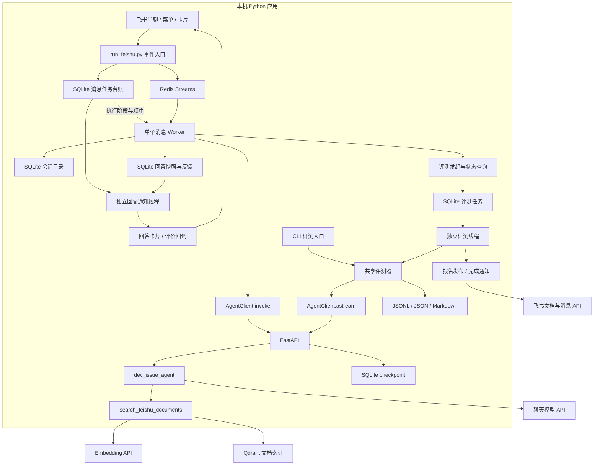
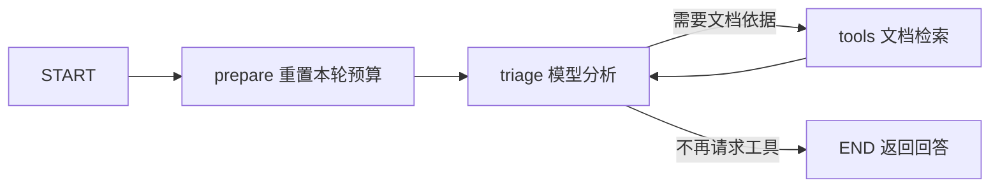
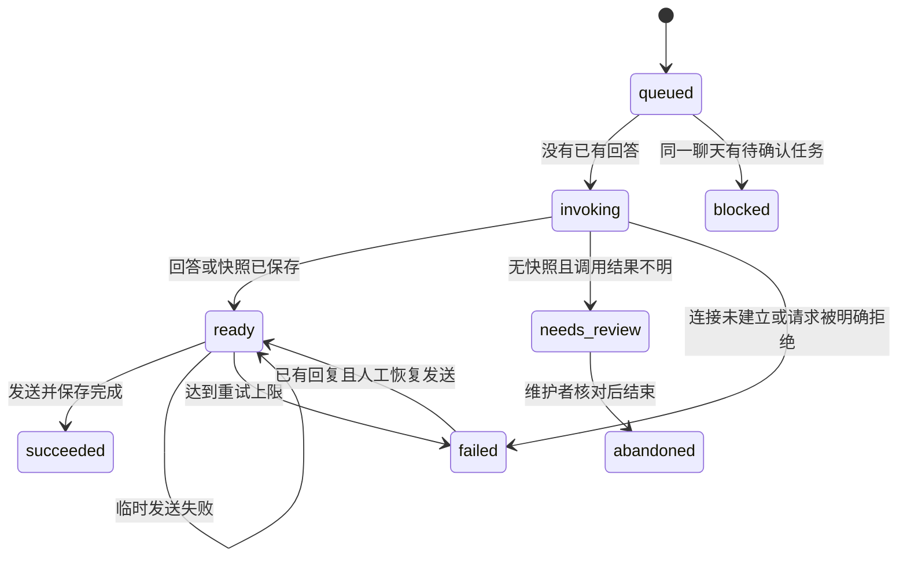

# SupportPilot 架构与状态流转

本文描述当前代码中的 SupportPilot 链路。Agent ID 为 `dev-issue-agent`，核心是单 Agent 工具循环；仓库保留的 Supervisor 示例没有接入该业务。

React 本地工作台位于 `frontend/`，通过 Node 端代理复用同一个 Agent 的 `/stream`、`/history`、`/threads` 和服务 `/info`。页面使用完整消息关联工具调用及结果，按用户轮次展示文档证据；token 仅作为当前消息草稿，完整 AI 消息到达后替换草稿。网页匿名用户编号保存在浏览器，会话内容保存在后端 checkpoint，与飞书会话目录独立。代理在服务端读取共享密钥，当前仅供本机使用，尚无登录与逐会话用户鉴权。启动与协议说明见 [React 工作台](../frontend/README.md)。

## 1. 进程与职责



Redis、Qdrant 由独立 Compose 运行。图中的 SQLite 库按职责分开，不能互相替代；跨库和远程 API 之间没有分布式事务。

普通问答 Worker 是飞书进程内的线程，不是独立工作进程。问答、会话操作、反馈与评测发起顺序处理；真正运行整轮评测的是另一线程。FastAPI 是另一个进程，负责模型执行和 checkpoint。

Redis + agent 模式另有独立回复通知线程：任务登记后即可显示回执，随实际阶段更新同一卡片。卡片状态保存在任务数据库的通知表中，独立于模型执行阶段；后续问题的接收回执不等待前一个模型调用。

## 2. 一条普通问题的路径

1. [run_feishu.py](../src/run_feishu.py) 的 `FeishuHandler.on_event` 接收文本，只保留用户单聊，识别确定的操作命令。
2. Redis 模式下，`_enqueue` 先将事件、类型和参数写入 [MessageTaskStore](../src/feishu_tasks.py)。唯一键检查重复事件；相同事件携带不同内容会被拒绝。
3. Lua 将任务 ID 写入 Stream，并保存带 TTL 的去重索引。正文留在 SQLite。若 Redis 写入失败，已提交台账作为待发布记录，连接恢复后补发。
4. Worker 持有本地操作系统文件锁，按台账序号处理最早活动任务，使用消费组领取或接管未确认记录。开始模型调用前保存阶段，实际请求前记录 `thread_id`、`user_id`。
5. `create_agent_reply` 先查既有回答快照；没有快照时，从 [feishu_sessions.py](../src/feishu_sessions.py) 取得当前线程，调用现有 `AgentClient.invoke`。
6. [service.py](../src/service/service.py) 的 `_handle_input` 创建 `run_id`，把线程、用户和模型写入 `RunnableConfig`；服务生命周期已为图绑定 checkpointer。
7. [dev_issue_agent.py](../src/agents/dev_issue_agent.py) 执行图，返回 AI 回答。桥接层将问题、答案、用户、线程和运行标识保存为不可变快照，再由 [回复通知线程](../src/feishu_progress.py) 复用接收卡片，通过反馈模块绑定快照并更新为最终答案。
8. Worker 将台账记为完成，再 ACK 并删除 Stream 中的任务条目。若完成后 ACK 失败，后续只补确认，不重复执行业务。

选择 `FEISHU_QUEUE_BACKEND=memory` 时仍走原有进程内队列与最近事件去重，不具备以上队列恢复能力。

## 3. Agent 与文档检索



目前唯一业务工具是 `search_feishu_documents`。每轮最多两次工具调用，每次只允许一个工具请求；整轮预算 65 秒，单次模型调用不超过 60 秒，检索工具外层超时 25 秒。飞书客户端默认等候 75 秒，评测每轮默认 90 秒；预算不是对外部系统耗时的绝对保证。

工具在 `asyncio.to_thread` 中复用同步 Embedding/Qdrant 调用，避免阻塞后端事件循环。外层超时后，只读 HTTP 请求可能继续执行到其自身超时；不能把停止等待当成远端已取消。

文档准备与在线检索是两条路径：

```text
离线准备：已授权 wiki/docx → 正文 JSON → 字符切分 → 文档向量 → Qdrant
在线检索：用户问题 → 同配置查询向量 → Top-K + 分数阈值 → 限长正文与出处 → 模型回答
```

[document_retrieval.py](../src/document_retrieval.py) 返回 `ok`、`no_results` 或 `error`。每个命中包含 `chunk_id`、`document_id`、标题、`source_url`、正文、得分和截断标记。相似度只用于检索过滤，不是事实正确率或根因置信度。

## 4. 标识从哪里来

消息任务另有追加式事件表，状态变化与事件同事务提交；查询、升级和受控恢复操作见 [任务流水与恢复审计](operations.md)。该流水不复制模型调用树，人工恢复要求原因，并保留本机 Worker 锁和未知执行结果保护。

| 标识 | 生成位置 | 保存与用途 |
| --- | --- | --- |
| `message_id` / `event_id` | 飞书平台事件 | 消息回复、任务去重、反馈与会话操作幂等 |
| 消息 `task_id` | `MessageTaskStore.enqueue`，命名空间和事件键的 SHA-256 | SQLite 台账、Redis 消息和 Worker 日志；不是后端 run_id |
| `thread_id` | 飞书首次映射使用 UUID5，新建会话使用 UUID4；通用 API 未传时生成 UUID4 | 会话目录保存当前选择，checkpoint 保存该线程消息 |
| `user_id` | 飞书桥接用初始单聊映射构造稳定标识；通用 API 未传时生成 UUID4 | 模型运行配置与快照；切换会话不改变飞书用户标识 |
| `run_id` | FastAPI `_handle_input` 每次请求创建 UUID7 | `RunnableConfig`、对外消息、回答快照和评测记录 |
| `tool_call_id` | 聊天模型工具调用消息 | ToolNode 结果携带相同 ID，评测据此匹配请求与结果 |
| `chunk_id` | 文档切分时按文档、内容、参数等生成稳定 UUID5 | Qdrant point ID、检索证据；用于追溯命中片段 |
| `snapshot_id` | `FeedbackStore.save_answer` 创建 UUID4 | 回答卡片提交值、不可变快照、首个有效评价 |
| 评测 `job_id` | `EvaluationJobStore.create` 创建 UUID4 | 飞书调度状态、报告位置、发布与通知记录 |
| `evaluation_id` | `run_evaluation` 创建评测运行标识 | manifest 与本地结果；不等同于每一轮模型 run_id |

`thread_id` 是会话定位键，不是凭证。飞书菜单、反馈和评测查询在业务层检查操作者归属；通用 API 的 Bearer 是共享访问令牌，不能描述为已实现完整多租户逐线程鉴权。

飞书使用 `/invoke` 获取最终 AI 消息，并保存其 `run_id`；它不会额外保存本轮完整工具轨迹。评测使用 `/stream` 的完整消息模式，收集 AI 工具请求、ToolMessage、最终回答及证据。对外 `ChatMessage` 没有独立 `thread_id` 字段，评测器保存自己传入的线程 ID。

## 5. 持久化分工

| 存储 | 默认位置 | 保存内容 |
| --- | --- | --- |
| LangGraph checkpoint | 根目录 `checkpoints.db`，可由 `SQLITE_DB_PATH` 改变 | 线程状态、消息与图执行记录 |
| 会话目录 | `.local/feishu-sessions.sqlite3` | 用户单聊映射、当前线程、历史元信息、会话操作事件 |
| 回答与反馈 | `.local/feishu-feedback.sqlite3` | 不可变答案快照、卡片绑定、首个有效评价 |
| 长期记忆事实 | `.local/agent-memory.sqlite3` | 用户明确陈述的环境事实；30 天过期，冲突不覆盖，多租户模式不启用 |
| 消息任务台账 | `.local/feishu-tasks.sqlite3` | 顺序、事件参数、执行阶段、回复引用、重试次数和错误 |
| 评测任务 | `.local/evaluation-jobs.sqlite3` | 案例快照、状态、结果目录、document_id、链接、失败与通知状态 |
| Redis Streams | `supportpilot-queue_redis_data` 命名卷 | 任务 ID、消费组与未确认记录、带 TTL 的去重索引 |
| Qdrant | `dev-issue-rag_qdrant_data` 命名卷 | 文档向量及含正文、出处的 payload |
| 评测文件 | `evals/supportpilot/runs/<运行编号>/` | 案例、manifest、逐轮 JSONL、汇总 JSON 与 Markdown 报告 |

Redis 去重 TTL 默认一天，SQLite 台账不随 TTL 自动清理。Redis AOF 每秒刷盘存在未落盘窗口，未完成任务可由 SQLite 待发布记录补发；两个存储同时丢失不在此恢复机制的保证内。

SQLite 模式的 LangGraph Store 仍是 `InMemoryStore`，与持久 checkpoint 不同。RAG 文档存于 Qdrant，不存于这个 Store。

## 6. 消息中断如何处理



重启发现 `invoking` 时，先查回答快照。已有快照则进入展示阶段：复用卡片编号，并核对通知版本是否已展示，绑定成功但更新失败的卡片仍需补更新；没有快照才标记 `needs_review`。后端在途模型请求可能继续执行，所以不会自动再次调用模型。该聊天的后续新问题记为 `blocked`，不会产生新的未知调用；其他聊天继续处理。能确认未建立连接或被认证、路由、参数校验拒绝的请求直接失败，不锁住后续消息。

普通成功发送但本地尚未绑定卡片 ID 的窗口，使用稳定发送 UUID 降低重复风险；SQLite 与飞书之间没有原子事务，不承诺跨任意时长严格只发送一次。

重启恢复是按业务阶段重新决定下一步，不是从 Python 崩溃的语句或 Agent 任意节点续跑。文件锁只协调共享同一台账的本机 Worker，不能扩展成跨机器锁。实际查询与人工处理见 [Redis 说明](operations.md)。

## 7. 反馈与评测报告

反馈路径：卡片提交 → 从事件读取真实操作者与聊天 → 校验快照归属及卡片绑定 → SQLite 保存首个有效评价 → 更新卡片。重复提交读取已保存结果，不改变首个评价；保存成功但卡片更新失败会明确提示已保存。

评测路径：

```text
菜单 /eval → 保存案例快照与 queued 任务 → 独立评测线程
  → 共用 run_evaluation → AgentClient.astream → 同一 dev-issue-agent
  → 本地结果 → 创建/写入飞书文档 → 授予并核对发起人阅读权限
  → 获取真实访问链接 → 发送完成卡片

CLI → 相同 run_evaluation → 相同后端 → 相同本地结果格式
```

固定集当前为 14 案例、18 轮；案例间新建线程，多轮案例内部复用线程。评测记录完整消息、检索命中、规则结果、总耗时与待人工复核的 rubric，不包含可靠的逐阶段延迟、Token 成本或自动语义质量判分。

调度状态为 `queued → running → publishing → succeeded`，失败分别记为 `failed` 或 `publish_failed`。进程重启时旧活动评测记为 `interrupted`，保留产物，不自动重跑；这与普通消息的恢复策略不同。

报告授权优先核对增加协作者响应的完整 member，响应不完整才查询成员列表，访问链接来自元数据接口。API 权限确认不代替发起人实际打开文档验收。发布失败保留本地报告和已创建的 document_id；通知失败单独记录，终态通知可在重启后补发。

## 8. 日志与已知边界

消息日志按 `task_id` 定位台账，通过 context 找到线程与 `trace_id`，通过 `snapshot_id` 找到 `run_id` 与答案；评测日志按 `job_id` 定位目录和逐轮 run_id。检索原始结果可从评测 JSONL 追溯。可选 Prometheus + Grafana 已接入任务状态、交付耗时、模型/检索操作耗时及失败指标，见 [运行监控](../monitoring/README.md)。Langfuse Cloud 通过回调采集 Agent、模型和工具调用，task_id、run_id 与会话信息通过 metadata 关联，默认不上传正文；接入和真实验收方法见 [调用追踪](operations.md)。SDK 初始化、合成 trace 验证和真实飞书问答验收是三种不同结论，应分别记录。

链接规则可能把答案中的配置示例 URL 当作无依据引用，仍是已知待修项；规则通过和报告发布成功都不代表答案质量通过。单 Agent、人工导入知识库、本机单 Worker 的边界是本版的实际实现。
